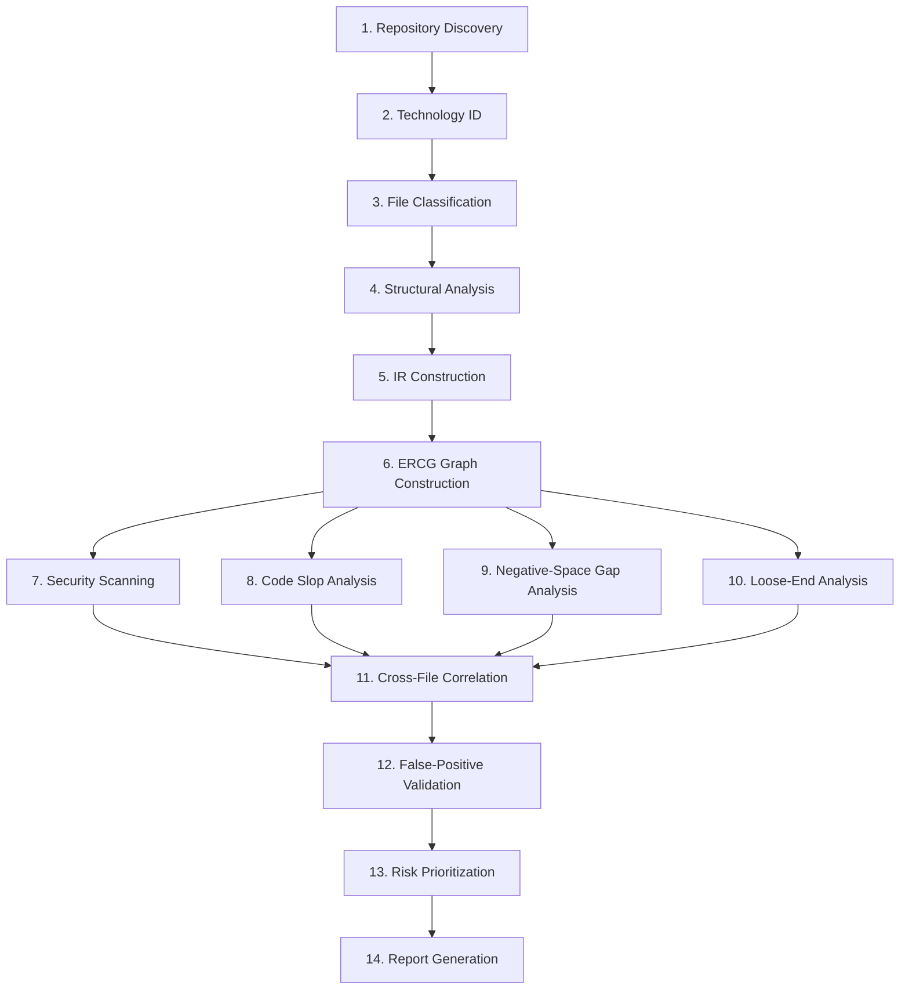

# TraceGuard Technical Architecture & Design Document

## 1. System Vision
TraceGuard is an architecture-agnostic repository integrity agent engineered to analyze complex software repositories without requiring explicit architectural declarations, framework tags, or environment configuration.

Rather than operating as a naive regex scanner or an opaque LLM wrapper, TraceGuard implements a deterministic **Evidence-Linked Repository Consistency Graph (ERCG)** coupled with **Negative-Space Analysis**.

---

## 2. Core Abstractions & Intermediate Representation (IR)

### 2.1 Nodes (Symbols)
Each structural entity in a repository is modeled as a unified `Symbol` in the IR:
- `MODULE`: Represents a file or package boundary.
- `FUNCTION`: Standalone procedures, methods, and asynchronous routines.
- `CLASS`: Object-oriented class structures, records, or structs.
- `INTERFACE`: Formal contracts (TypeScript `interface`, Go `interface`, Python `ABC`/`Protocol`).
- `ENDPOINT`: Server-side API route declarations (FastAPI, Flask, Express, Next.js, Gin, Spring).
- `API_CALL`: Client-side HTTP requests (`fetch`, `axios`, `apiClient`).
- `DB_MODEL`: ORM entities (`Base`, `db.Model`, `__tablename__`).
- `DB_MIGRATION`: Version-controlled schema migrations (Alembic, Flyway, Rails).
- `CONFIG`: Configuration and environment references (`os.getenv`, `process.env`, `.env`).
- `SINK`: Security-sensitive execution targets (`db.execute`, `os.system`, `pickle.loads`).
- `GUARD`: Authorization checks (`@require_auth`, middleware, dependency guards).

### 2.2 Relations (Edges)
Edges in the ERCG capture semantic coupling:
- `CALLS`: Direct or indirect function invocation.
- `ROUTES_TO`: Link between client-side API call and server-side endpoint handler.
- `DEFINES`: Parent-child scope containment.
- `USES_CONFIG`: Access to an environment or configuration key.
- `QUERIES_DB`: Interaction with database persistence.
- `TESTS`: Direct automated test assertion over a target symbol or module.
- `GUARDS`: Authorization and authentication boundary defending a sensitive sink or endpoint.
- `DATA_FLOW_TO`: Source-to-sink variable or control flow propagation.

---

## 3. Negative-Space Analysis Protocol

Negative-space analysis is TraceGuard's distinctive method for discovering what is *absent*. It follows a strict 7-step protocol:

1. **Identify Expected Relationship**: Determine whether a declared entity (e.g. client fetch, database model, interface) implies a complementary component (backend route, migration, concrete implementation).
2. **Establish Expectation Rationale**: Formulate the technical rationale (e.g. "Client initiates network request to path X; without server route, client receives 404").
3. **Search Supporting Evidence**: Query the ERCG for direct matches.
4. **Search Alternative Implementations**: Explore dynamic parameter mappings (`:id` vs `{id}` vs `<id>`), wildcard routers, or reflection.
5. **Check Legitimate Exceptions**: Exclude external third-party origins (`https://api.stripe.com`), test fixtures, or static asset paths.
6. **Assign Confidence**: Score confidence between 0.0 and 1.0 based on search completeness.
7. **Report Actionable Findings**: Emit findings with explicit counterevidence considered.

---

## 4. The 14-Step Execution Pipeline

---

## 5. False-Positive Mitigation

Every finding emitted by TraceGuard carries two mandatory evidence attributes:
- `supporting_evidence`: Line numbers, syntax matches, and call-graph paths proving the defect.
- `counterevidence_considered`: Explicit list of safety mechanisms checked (e.g. "Checked for parameterized query placeholders", "Checked if endpoint is public health check", "Checked for wildcard route handler").

Verification status is assigned as:
- **`Confirmed`**: High confidence (≥88%) supported by multiple direct evidence markers.
- **`Probable`**: Strong evidence (≥70%) with minor peripheral context missing.
- **`Needs review`**: Suspicious pattern requiring human engineering inspection.
