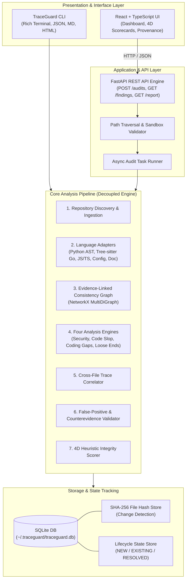

# TraceGuard Technical Architecture & Design Document

## 1. System Vision & Design Philosophy

TraceGuard is an architecture-agnostic repository integrity agent engineered to analyze complex, heterogeneous software repositories without requiring hardcoded framework tags, environment configuration, or proprietary build steps.

TraceGuard does not rely on naive keyword scanning or non-deterministic large language model prompts for structural discovery. Instead, it combines a deterministic **Evidence-Linked Repository Consistency Graph (ERCG)** with a rigorous **Negative-Space Analysis Protocol**.

The core analysis engine is completely decoupled from web frameworks, allowing both the **Command-Line Interface (CLI)** and the **FastAPI REST API** to execute identical analysis workflows against the repository graph.

---

## 2. System Architecture

---

## 3. Evidence-Linked Repository Consistency Graph (ERCG)

The ERCG is an in-memory directed multi-graph implemented with **NetworkX** that models semantic relationships across files, functions, routes, data models, configurations, and sinks.

### 3.1 Node Definitions (`NodeType`)
- `FILE` / `MODULE`: Source files and package boundaries.
- `FUNCTION`: Procedures, methods, and asynchronous coroutines.
- `CLASS`: Structs, classes, and records.
- `INTERFACE`: Formal interface contracts (Go `interface`, TypeScript `interface`, Python `ABC`/`Protocol`).
- `ENDPOINT`: Server-side route handlers (FastAPI, Flask, Express, Next.js, Gin, Echo).
- `API_CALL`: Client-side network invocations (`fetch`, `axios`, `httpClient`).
- `DB_MODEL`: ORM entities (`SQLAlchemy`, `Prisma`, `GORM`).
- `DB_MIGRATION`: Schema version migrations (Alembic, Flyway, Goose).
- `CONFIG`: Configuration keys (`os.getenv`, `process.env`, `.env`).
- `SINK`: Security-critical operations (`db.execute`, `subprocess.run`, `eval`, `pickle.loads`).
- `GUARD`: Authentication and authorization barriers (`Depends(...)`, middleware, decorators).

### 3.2 Edge Definitions (`EdgeType`)
- `CALLS`: Direct or indirect function execution.
- `ROUTES_TO`: Link between client-side API call and server-side endpoint handler.
- `DEFINES`: Parent-child scope containment.
- `USES_CONFIG`: Variable reference to an environment or configuration key.
- `QUERIES_DB`: Persistence and query operations.
- `TESTS`: Automated test assertions covering target procedures.
- `GUARDS`: Authorization boundaries defending sensitive endpoints or sinks.
- `DATA_FLOW_TO`: Source-to-sink variable propagation paths.

### 3.3 Relationship Resolution States (`EdgeResolution`)
To ensure unextracted relationships are never misconstrued as proof of absence:
- `CONFIRMED`: Directly validated via AST analysis or compiler binding.
- `INFERRED`: Derived via route normalization, naming convention, or dynamic pattern.
- `UNRESOLVED`: Target cannot be statically resolved from visible code.
- `UNSUPPORTED`: Language in file currently relies on lexical fallback.

### 3.4 Graph Coverage Metrics
Every audit computes:
$$\text{Resolution Rate} = \frac{\text{Resolved Relations}}{\text{Total Relations}}$$
Tracking language coverage tiers across the repository to indicate overall graph fidelity.

---

## 4. Go Implicit Interface Method-Set Analysis

Go uses implicit interface satisfaction rather than explicit inheritance declarations. TraceGuard implements method-set analysis using **Tree-sitter Go**:

### 4.1 Satisfaction Model
For an interface $I$ requiring method set $\mathcal{M}(I)$:
1. A value receiver method on concrete type $T$ belongs to both the value method set $\mathcal{M}_v(T)$ and pointer method set $\mathcal{M}_p(T)$.
2. A pointer receiver method `func (t *T) Method()` belongs exclusively to $\mathcal{M}_p(T)$.
3. Value satisfaction: Type $T$ satisfies $I$ if:
   $$\mathcal{M}(I) \subseteq \mathcal{M}_v(T)$$
4. Pointer satisfaction: Pointer type $*T$ satisfies $I$ if:
   $$\mathcal{M}(I) \subseteq \mathcal{M}_p(T)$$

If $\mathcal{M}(I) \cap \mathcal{M}_p(T) \neq \emptyset$ but $\mathcal{M}(I) \not\subseteq \mathcal{M}_p(T)$, the type is categorized as a **partial implementor** and flagged with missing methods rather than assuming no relation exists.

---

## 5. Negative-Space Analysis Protocol

Negative-space analysis discovers critical architectural omissions by verifying expected relationships against repository evidence:

1. **Establish Expected Relationship**: Formulate expected pairing (e.g., client route request $\rightarrow$ backend endpoint).
2. **Identify Expectation Source**: Pinpoint origin in client code or OpenAPI documentation.
3. **Exhaustive Repository Search**: Query registered endpoints in ERCG.
4. **Alternative Implementation Search**: Search parameterized variations (`:id`, `{id}`, `<id>`), query string endpoints, and wildcard routers.
5. **Dynamic Routing / Middleware Verification**: Inspect router prefixes and dynamic router mounting.
6. **Legitimate Architectural Exceptions**: Exclude external third-party URLs (`https://api.stripe.com`), CDN assets, and public webhooks.
7. **Produce Evidence & Counterevidence**: Document matched routes, rejected alternatives, and files scanned.
8. **Calibrate Confidence**: Assign `Confirmed` ($\ge 0.85$), `Probable` ($\ge 0.70$), or `Needs review` ($< 0.70$).

---

## 6. Four-Dimensional Integrity Scoring

TraceGuard evaluates repositories across four orthogonal dimensions (0–100 scale):

### 6.1 Dimension Formulation
- **Security Risk ($S_{\text{sec}}$)**: Deductions for injection, broken auth, secret exposure, and weak crypto.
- **Implementation Completeness ($S_{\text{comp}}$)**: Deductions for missing routes, unimplemented interfaces, and mock endpoints.
- **Code Quality ($S_{\text{qual}}$)**: Deductions for dead code, swallowed exceptions, and redundant wrappers.
- **Development Hygiene ($S_{\text{hyg}}$)**: Deductions for unconfigured environment variables, debug artifacts, and unresolved TODOs.

### 6.2 Overall Weighted Composite
$$\text{Overall Score} = 0.40 \cdot S_{\text{sec}} + 0.30 \cdot S_{\text{comp}} + 0.20 \cdot S_{\text{qual}} + 0.10 \cdot S_{\text{hyg}}$$

Deduction per finding:
$$\Delta = \text{SeverityWeight} \times \text{Confidence} \times \text{StatusMultiplier}$$
- Severity weights: `critical=15.0`, `high=7.0`, `medium=3.0`, `low=1.0`, `info=0.3`.
- Status multipliers: `Confirmed=1.0`, `Probable=0.7`, `Needs review=0.4`.

### 6.3 Sufficiency Guard & Disclaimer
- If `total_files < 3` or `total_lines < 10`, score output displays `INSUFFICIENT_EVIDENCE`.
- **Mandatory Disclaimer**: Scores represent heuristic engineering indicators based on static analysis. They do not constitute an official security certification, penetration test, or compliance audit.

---

## 7. Change-Aware Incremental Auditing & Lifecycle Tracking

TraceGuard persists file-level SHA-256 hashes in SQLite. When an audit is re-run:
1. `diff_hashes(prev, curr)` identifies modified, added, and deleted files.
2. Stable Finding IDs (`Finding.compute_stable_id()`) remain invariant across shifting line numbers:
   $$\text{Stable ID} = \text{SHA256}(\text{category} : \text{subcategory} : \text{file} : \text{title})[0:12]$$
3. Findings transition across lifecycle states:
   - `NEW`: First observed in current audit.
   - `EXISTING`: Present in previous and current audits.
   - `RESOLVED`: Present in previous audit but absent in current audit.
   - `REINTRODUCED`: Previously resolved defect that has reappeared.
   - `ACCEPTED_RISK`: Marked by team as accepted risk.

---

## 8. REST API & Web Dashboard Architecture

The FastAPI backend exposes stateless REST endpoints and executes audit tasks in asynchronous background runners:
- **Sandbox Containment**: Strict path traversal validation rejects paths targeting system directories or symbolic links escaping the project root.
- **Background Execution**: Long-running scans execute asynchronously; clients poll audit status by UUID.
- **React 18 / TypeScript Web Dashboard**: Interfaces with the REST API to display interactive scorecards, paginated findings with filter controls, and collapsible provenance details.
