<div align="center">

# 🛡️ TraceGuard
### **Architecture-Agnostic Repository Integrity Agent**

*Understand your codebase. Find what others miss.*

[](https://www.python.org/downloads/)
[](https://fastapi.tiangolo.com)
[](https://react.dev)
[](https://www.typescriptlang.org)
[](https://networkx.org/)
[](https://tree-sitter.github.io/tree-sitter/)
[](https://www.sqlite.org/)
[](#automated-test-suite)
[](#benchmark-evaluation-across-9-polyglot-repositories)
[](#safety-security--disclaimer)
[](https://opensource.org/licenses/MIT)

</div>

---

## 🎯 Executive Summary

**TraceGuard** is a deterministic, **architecture-agnostic software engineering intelligence agent** that audits polyglot repositories to uncover **security vulnerabilities**, **code slop**, **coding gaps (negative-space omissions)**, and **loose ends**—with line-by-line source evidence you can investigate.

Unlike traditional single-file linters or brittle LLM-only wrappers, TraceGuard constructs an in-memory **Evidence-Linked Repository Consistency Graph (ERCG)** using **Python AST**, **Tree-sitter Go**, and **JS/TS structural adapters**. By modeling relationships across frontend network calls, backend route handlers, database models, migrations, interfaces, configs, and test files, TraceGuard detects **both what is broken in code and what is missing between components**—without making assumptions about folder layout or framework conventions.

### Why TraceGuard Stands Out
- **Zero Framework Assumptions**: Works seamlessly across full-stack SPAs, microservices, monoliths, headless APIs, and background workers.
- **4 Specialized Analysis Engines**: Security Risk, Code Slop, Negative-Space Coding Gaps, and Development Hygiene.
- **False-Positive Trap Rejection**: Every finding records both `supporting_evidence` and `counterevidence_considered`.
- **Change-Aware Incremental Auditing**: SHA-256 file hashing + SQLite persistence tracks `NEW`, `EXISTING`, `RESOLVED`, and `REINTRODUCED` findings across runs.
- **Dual Delivery**: Shared core engine powering a **Rich CLI**, an async **FastAPI REST API**, and a **React + TypeScript Web Studio** with interactive **2D & 3D Graph Architecture** views.

---

## 🖼️ Product Showcase (Live UI Screenshots)

### 1. Landing Overview & Illustrative ERCG Preview
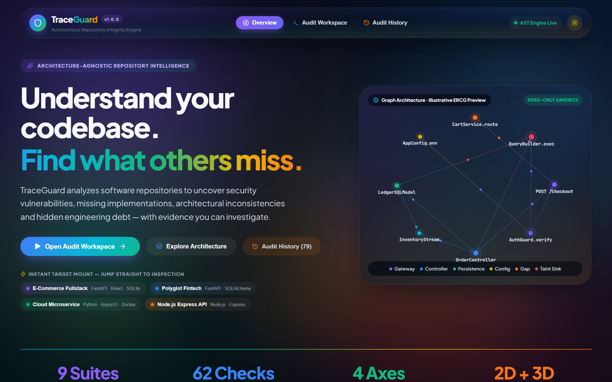

### 2. Audit Workspace (Benchmark Suites & Custom Mounts)
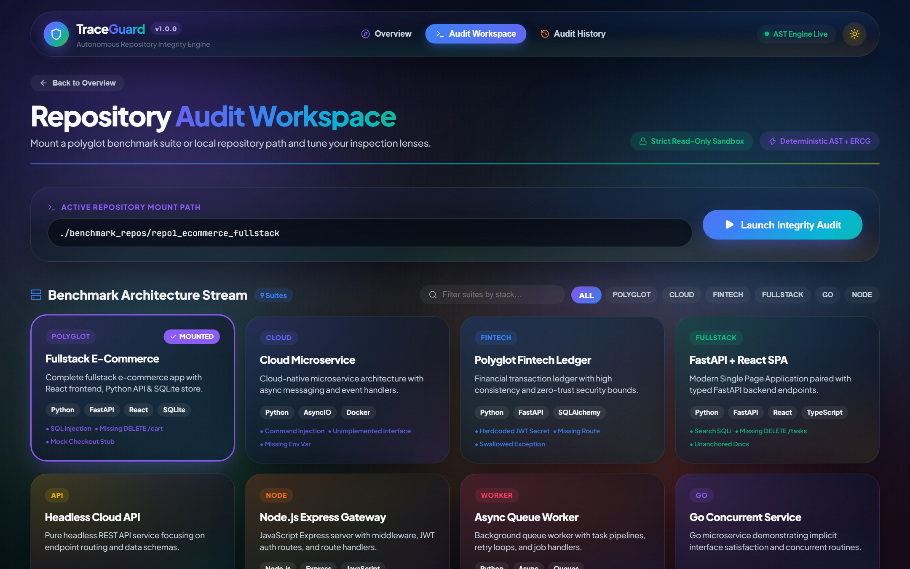

### 3. Live Intelligence Overview Dashboard
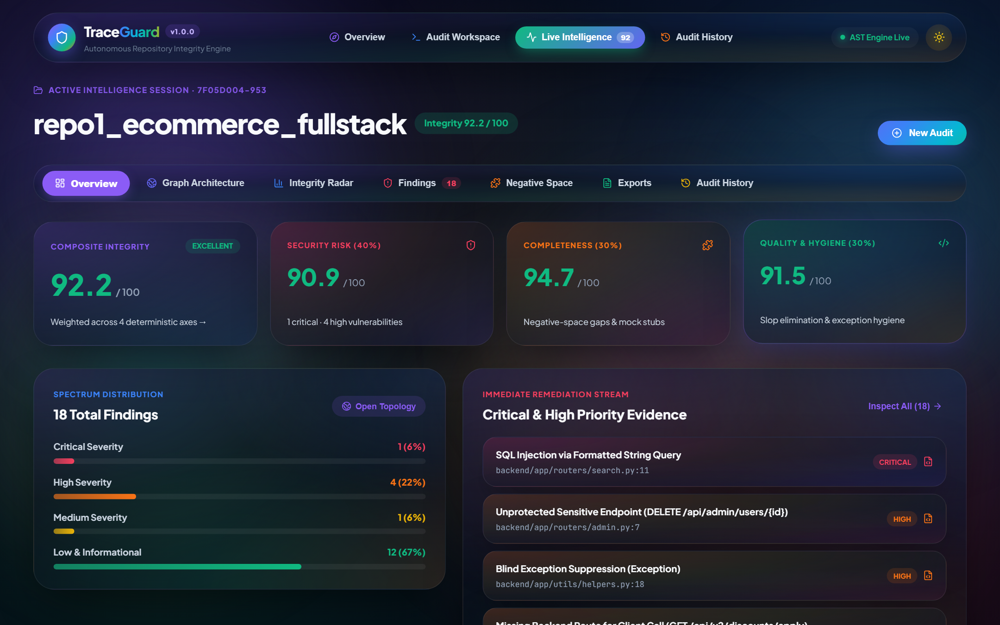

### 4. 2D Graph Architecture (Stratified Dependency & Defect Topology)
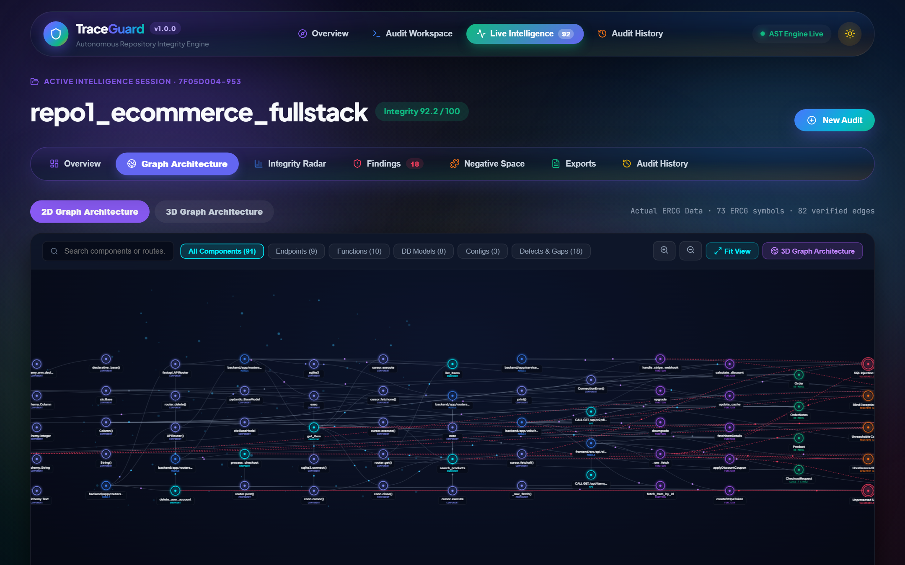

### 5. 3D Graph Architecture (Interactive WebGL Sphere)
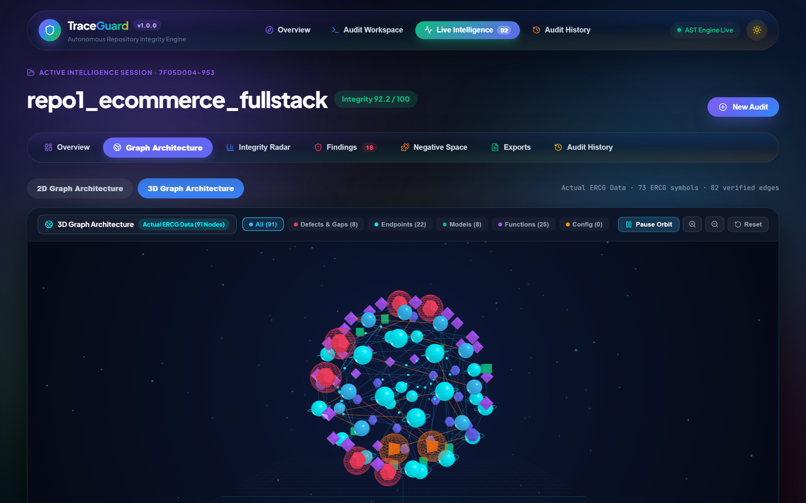

### 6. 4-Dimensional Integrity Radar & Breakdown
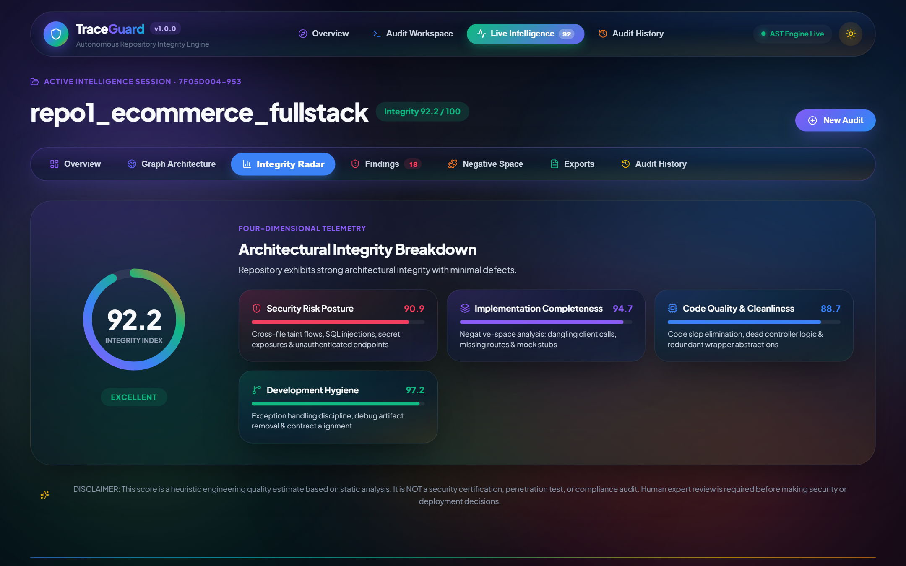

### 7. Findings Explorer (Evidence, Root Cause & Copyable Remediation)
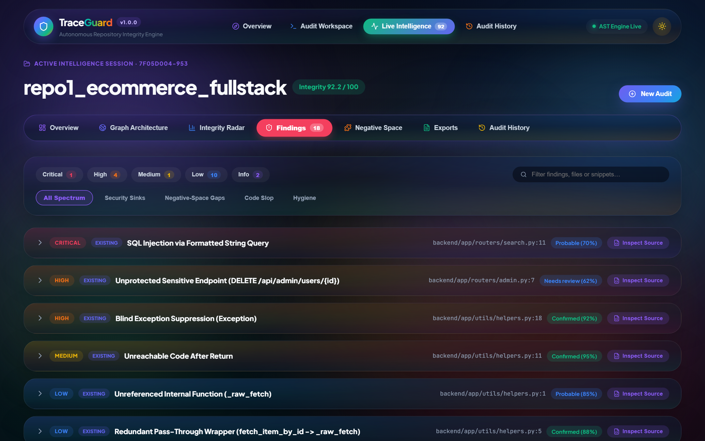

### 8. Negative-Space Architectural Analysis (Missing Routes & Mock Stubs)
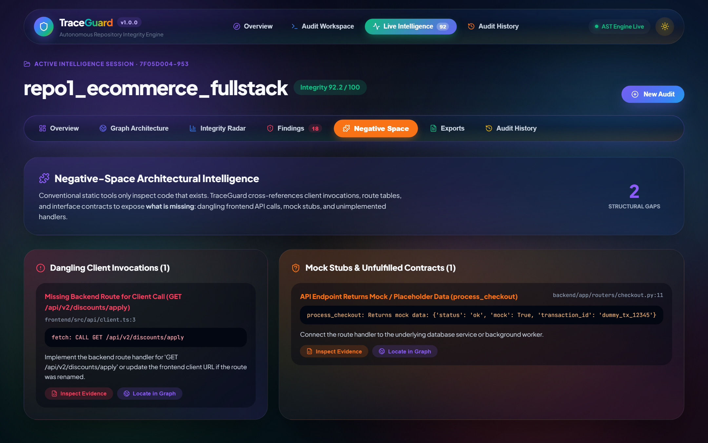

### 9. SQLite Audit History & Side-by-Side Delta Engine
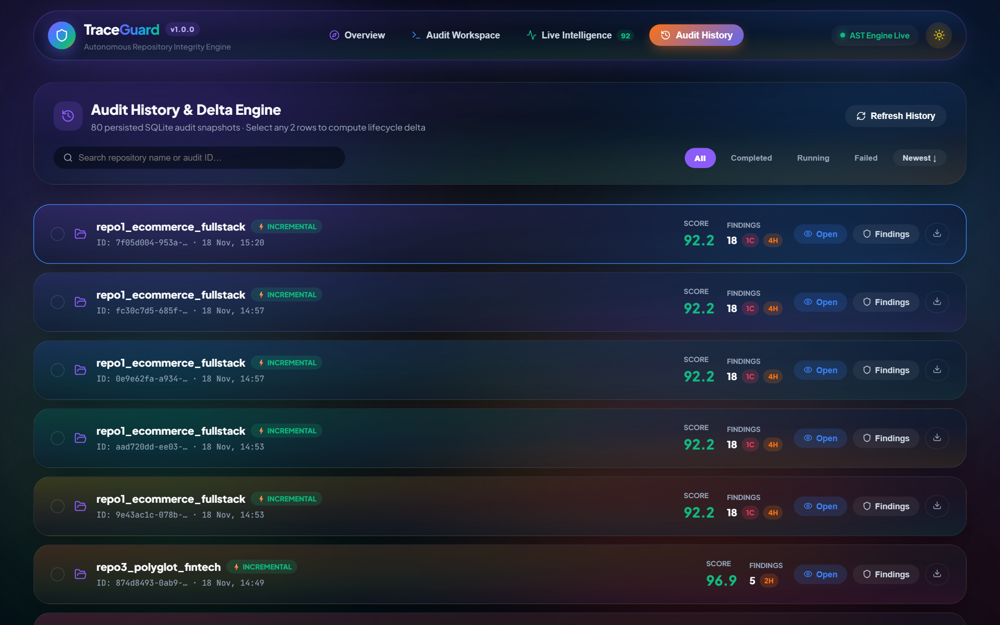

---

## 🏗️ System Architecture

TraceGuard decouples its core analysis pipeline from presentation and transport layers so the CLI and FastAPI/React web interface execute the exact same deterministic workflow.

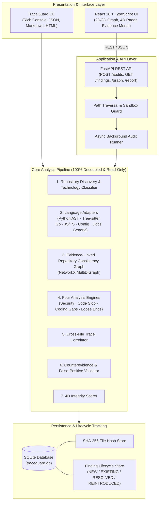

---

## 🔄 14-Stage End-to-End Audit Flowchart

Every repository audit follows a deterministic 14-stage pipeline from ingestion to multi-format reporting:

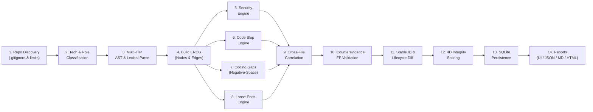

---

## 🧠 The 4 Analysis Engines

| Engine | Category | What It Detects |
| :--- | :--- | :--- |
| **Security Engine** (`security.py`) | `security` | • **Hardcoded Secrets**: AWS keys, GitHub PATs, private keys, JWT/DB secrets (with automatic masking).<br>• **Injection Sinks**: SQL injection (f-strings, `%`, concatenation) & OS command injection (`os.system`, `subprocess(..., shell=True)`, Node `exec`).<br>• **Unsafe Deserialization & Crypto**: `pickle.loads`, `yaml.load` without `SafeLoader`, MD5/SHA-1 credentials, AES-ECB.<br>• **Access Control & Configs**: Unprotected sensitive/admin endpoints (ERCG-correlated), path traversal, `verify=False`, wildcard CORS, vulnerable `requirements.txt` pins. |
| **Code Slop Engine** (`slop.py`) | `slop` | • **Blind Exception Suppression**: `except ...: pass` in Python and empty `catch {}` blocks in JS/TS.<br>• **Dead & Unreachable Code**: Statements after `return`/`raise` + unreferenced private functions with 0 callers and 0 tests.<br>• **Redundant Wrappers**: 1-line pass-through identity functions adding zero abstraction.<br>• **Complexity & Duplication**: Excessive nesting ($\ge 5$ levels), empty stub methods, cross-file duplicate implementations, unused imports. |
| **Coding Gap Engine** (`gap.py`) | `gap` | • **Missing Backend Routes**: Frontend `fetch`/`axios` calls with no matching backend route handler (supports `{id}`/`:id` normalization).<br>• **Undelivered Specs**: API routes documented in `README.md`/docs that do not exist in source code.<br>• **Unimplemented Interfaces**: Python `ABC`/`Protocol` and Go `interface` contracts lacking concrete implementations (via Tree-sitter method-set + pointer/value receiver analysis).<br>• **Schema & Stub Gaps**: ORM models missing migrations, live endpoints returning mock/placeholder data, unhandled DB commits/payments. |
| **Loose End Engine** (`loose_end.py`) | `loose_end` | • **Actionable Developer Markers**: `TODO`, `FIXME`, `HACK`, `XXX` with urgency-calibrated severity.<br>• **Leftover Debug Artifacts**: `pdb.set_trace()`, `breakpoint()`, `debugger;`, `console.log`, debug prints.<br>• **Commented-Out Code**: Multi-line ($\ge 3$ lines) commented implementation blocks.<br>• **Config & Test Gaps**: Environment variables (`os.getenv`/`process.env`) missing from `.env`/`.env.example`, and API routes with 0 test coverage. |

---

## 📊 4-Dimensional Integrity Scoring

TraceGuard computes an objective composite score ($0\text{–}100$) across four weighted engineering axes:

$$\text{Overall Score} = 0.40 \times \text{Security} + 0.30 \times \text{Completeness} + 0.20 \times \text{Code Quality} + 0.10 \times \text{Hygiene}$$

- **Penalty Formula**: $\text{Deduction} = \text{SeverityWeight} \times \text{Confidence} \times \text{VerificationMultiplier}$
  - **Severity Weights**: `CRITICAL = 15.0`, `HIGH = 7.0`, `MEDIUM = 3.0`, `LOW = 1.0`, `INFO = 0.3`
  - **Verification Multipliers**: `Confirmed = 1.0`, `Probable = 0.7`, `Needs review = 0.4`
- **Evidence Sufficiency Guard**: Evaluates repository size (`ADEQUATE`, `LIMITED`, `INSUFFICIENT_EVIDENCE`) and always attaches a clear heuristic disclaimer.

---

## 🌐 Language Support Tiers

| Tier | Languages | Parser Mechanism | Capabilities |
| :--- | :--- | :--- | :--- |
| **Deep AST** | Python (`.py`) | Python `ast` module | Full call graph, classes, functions, decorators, async handlers, route extraction, SQL/exec sinks, imports |
| **Tree-sitter AST** | Go (`.go`) | `tree-sitter-go` grammar | Interface method extraction, struct declarations, pointer vs. value receiver method sets, implicit satisfaction |
| **Structural Lexical** | JS / TS (`.js`, `.jsx`, `.ts`, `.tsx`) | Regex + Template parser | Route declarations (Express, Next.js), client `fetch`/`axios` calls, template literal URLs, export bindings |
| **Configuration** | `.env`, YAML, JSON, TOML, INI | Schema & KV parsers | Environment key definitions, configuration references, secret detection |
| **Documentation** | Markdown (`.md`), OpenAPI | Structural doc parser | Declared API specifications, documented endpoint route matching |
| **Graceful Fallback** | Java, C#, C/C++, Rust, Ruby, PHP, Shell | Lexical fallback parser | Module, function, and class declarations, URL routes, secrets |

---

## 📈 Benchmark Evaluation Across 9 Polyglot Repositories

TraceGuard ships with **9 controlled benchmark repositories** and deliberate false-positive traps:

| Suite | Target Repository | Architecture & Tech Stack | Known Defects | Detected (TP) | False Negatives | Recall | Exec Time |
| :---: | :--- | :--- | :---: | :---: | :---: | :---: | :---: |
| **Repo 1** | `repo1_ecommerce_fullstack` | Full-Stack FastAPI + React/TS + SQLite | 9 | 8 | 1 | 88.9% | 0.055s |
| **Repo 2** | `repo2_cloud_microservice` | Go Daemon + Python CLI | 5 | 5 | 0 | 100.0% | 0.032s |
| **Repo 3** | `repo3_polyglot_fintech` | Node.js Express Gateway + Python Analytics | 3 | 3 | 0 | 100.0% | 0.018s |
| **Repo 4** | `repo4_fastapi_react` | FastAPI + React Task Manager | 3 | 3 | 0 | 100.0% | 0.025s |
| **Repo 5** | `repo5_fastapi_only` | FastAPI Analytics Service | 2 | 2 | 0 | 100.0% | 0.017s |
| **Repo 6** | `repo6_node_express` | Node.js Express Application | 3 | 3 | 0 | 100.0% | 0.018s |
| **Repo 7** | `repo7_python_worker` | Python Worker Queue (Celery/RQ style) | 2 | 2 | 0 | 100.0% | 0.021s |
| **Repo 8** | `repo8_go_microservice` | Go Microservice (Implicit Interfaces) | 2 | 2 | 0 | 100.0% | 0.015s |
| **Repo 9** | `repo9_python_monolith` | Python Modular Monolith | 1 | 1 | 0 | 100.0% | 0.012s |
| **Total** | **All 9 Benchmark Suites** | **Polyglot & Heterogeneous** | **30** | **29** | **1** | **96.7%** | **0.024s avg** |

---

## 🚀 Quick Start

### 1. Installation
```bash
git clone https://github.com/NikithaKunapareddy/TRACEGUARD.git
cd TRACEGUARD
python -m pip install -e ".[dev]"
```

### 2. Run via CLI
```bash
# Audit current repository (Rich terminal output)
traceguard audit .

# Export Markdown, interactive HTML, or structured JSON
traceguard audit ./benchmark_repos/repo1_ecommerce_fullstack --format markdown --output ./report.md
traceguard audit ./benchmark_repos/repo1_ecommerce_fullstack --format html --output ./dashboard.html
traceguard audit ./benchmark_repos/repo1_ecommerce_fullstack --format json --output ./audit.json

# Filter by category or minimum severity
traceguard audit . --category security --severity high
```

### 3. Run via FastAPI + React Web Studio
```bash
# Terminal 1: Start the FastAPI backend (also serves built UI at http://127.0.0.1:8000/dashboard/)
python -m uvicorn traceguard.api.app:app --host 127.0.0.1 --port 8000 --reload

# Terminal 2 (optional dev mode): Start Vite dev server
cd frontend
npm install
npm run dev
```

#### Key REST API Endpoints
- `GET  /api/v1/health` — Engine health & version status
- `POST /api/v1/audits` — Enqueue repository audit (with path traversal & system directory guards)
- `GET  /api/v1/audits/{id}` — Query audit status, 4D scores, and summary verdict
- `GET  /api/v1/audits/{id}/findings` — Paginated findings with category & severity filters
- `GET  /api/v1/audits/{id}/findings/{finding_id}/source` — Line-by-line on-disk source evidence
- `GET  /api/v1/audits/{id}/graph` — ERCG nodes, edges, and coverage metrics
- `GET  /api/v1/audits/{id}/report` — Export in `json`, `markdown`, or `html`
- `GET  /api/v1/audits/{id1}/compare/{id2}` — Side-by-side lifecycle delta comparison

---

## 🧪 Automated Test Suite

TraceGuard is backed by **62 automated tests** (`pytest`) covering adapters, ERCG graph indexing, Go implicit interfaces, incremental SQLite lifecycle tracking, scoring calibration, false-positive trap rejection, API security, and all 9 benchmark repositories:

```bash
python -m pytest tests/ -v
# 62 passed
```

- `tests/test_adapters.py` — Language parser & metadata extraction
- `tests/test_api.py` — FastAPI lifecycle, validation & path traversal rejection
- `tests/test_audit_history.py` — SQLite persistence, pagination & audit comparison
- `tests/test_benchmarks.py` & `tests/test_benchmarks_expanded.py` — Benchmark suites 1–9
- `tests/test_false_positives.py` — False-positive trap rejection across benchmarks
- `tests/test_go_interface_analysis.py` — Go pointer/value receiver method-set satisfaction
- `tests/test_graph.py` — ERCG indexing, route normalization & reachability
- `tests/test_incremental.py` — SHA-256 hash diffing & lifecycle transitions
- `tests/test_read_only_safety.py` — Strict non-destructive execution verification
- `tests/test_scoring.py` & `tests/test_security_calibration.py` — 4D scoring & counterevidence checks

---

## 🔒 Safety, Security & Disclaimer

1. **100% Read-Only Execution**: TraceGuard never creates, modifies, or deletes files in target repositories.
2. **Automatic Secret Redaction**: Exposed AWS keys, GitHub tokens, private keys, and credentials are masked in all logs, API responses, and reports (`AKIA************1234`).
3. **Sandbox Path Validation**: The FastAPI server blocks path traversal and forbids scanning OS system directories.
4. **Heuristic Assessment Disclaimer**: Integrity scores are static engineering quality indicators and do **not** replace formal penetration testing, compliance audits, or human security review.
